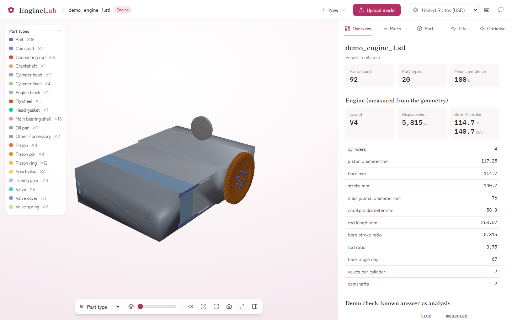

# EngineLab

[](https://github.com/jeremygideonbareh/enginelab/actions/workflows/ci.yml)
[](LICENSE)


**Open-source CAD analysis for robotics, mechanical and automotive engineers.** Drop in a CAD
assembly (STEP, IGES, native SolidWorks, STL, OBJ, GLB, 3MF) and EngineLab breaks it into its parts,
identifies and measures each one, recommends materials, tests parts on a virtual test bench and with
FEA, prices the parts list for your country, and, for engines, simulates thousands of operating hours
to find what fails first. Everything runs locally in your browser; no CAD software or cloud needed.



## Quick start

```bash
git clone https://github.com/jeremygideonbareh/enginelab.git
cd enginelab
python -m venv .venv
# Windows: .venv\Scripts\activate     macOS / Linux: source .venv/bin/activate
pip install -r requirements.txt
python tools/download_models.py --samples   # trained models (~95 MB) + 3 open-source sample robots
python run.py                               # then open http://127.0.0.1:8000
```

Click **New → Demo engine** to try it without a file, or open one of the sample robot arms.
Docker: `python tools/build_space.py` then `docker build -t enginelab deploy/space` (see `deploy/DEPLOY.md`).

Requirements: Python 3.12+, about 4 GB of RAM (8 GB for very large assemblies). Works on Windows,
macOS and Linux; no GPU needed.

## What it does

Upload a 3D model of an engine (or another machine). EngineLab:

1. **Breaks it into its parts.** CAD solids from STEP/IGES are kept exactly. Mesh files are split into closed shells, and fused meshes are cut along concave creases.
2. **Identifies every part**: piston, conrod, crankshaft, cam, valve, spring, bearing shell, gear, bolt and more. It combines CAD names, a machine-learning model trained on generated engines, and assembly reasoning.
3. **Measures specifications** from the geometry: size, mass, holes, bore, stroke (from the crank throw), rod centre distance, gear teeth, spring wire and coils, bolt threads, crown thickness, cylinder layout and bank angle.
4. **Recommends materials** by running each candidate through that part's own physics, then ranking on life, mass, cost and margin, with reasons.
5. **Tests each part** on a test bench (any speed, load, peak pressure or temperature, plus a pressure sweep) and with voxel FEA (axial, bending, torsion or pressure, shown as a stress heat map).
6. **Simulates thousands of operating hours.** It solves the thermodynamic engine cycle at every point of a duty cycle, loads every part, and runs a Monte Carlo of virtual engines with fatigue, wear and degradation coupling. The output is failure probabilities, B10/B50 lives, the failing part, its failure mode and where it fails.

## Making parts better (`enginelab/improve.py`)

- **Material menu** (Part tab): every material, grouped by category, with its properties beside the current one. Picking a material runs an engine simulation before you apply anything, showing the part's life, safety factor and mass, the engine life, and knock-on effects on other parts.
- **How to make this part better** (Part tab): every design lever for that part is simulated and ranked:
  - material;
  - geometry: crown thickness, pin bore, rod shank section, crankpin diameter;
  - surface treatment: fillet deep-rolling, nitriding, shot peening, hard anodising;
  - coatings on the skirt and ring faces;
  - crown cooling: oil jets or a gallery.

  Each suggestion shows its effect on the part, the engine and other parts. A lighter pin, for example, unloads the rod and crankshaft. Changes that weaken another part, or shorten any part's life, are marked as trade-offs. One click applies a change; it can be reset to the uploaded design.
- **Optimise tab: a self-improving design optimiser.** It runs engine simulations continuously, about 25 ms each:
  - A random-forest surrogate is retrained on every result and chooses the next designs by predicted score plus uncertainty.
  - Its prediction error falls as it learns (shown live).
  - Every simulation is saved in `data/optimizer/`, so re-opening the same engine continues from what it already knows.
  - Goals: balanced, longest life, or lightest design meeting a target life.

  On the native SolidWorks inline-4 (1,000+ simulations), the best design doubled Monte Carlo B10 life (6,400 → 13,000 h) and cut engines failing by 10,000 h from 63% to 2%, while saving 3.4 kg. Every safety factor stayed ≥ 1.9.

## Buying the parts (`enginelab/sourcing.py`, Parts tab → Buy & cost)

- **Country selector** (top bar): prices are converted to the local currency at today's rate (free FX API, with a fallback table).
- **Every standard part** gets a typical price range for its kind and size, and up to five shops with ready search links, local shops first. For India: Robu.in, Industrybuying, Amazon.in, Robocraze, MISUMI India and element14. Search formats were checked in a browser, and Robu's real 608ZZ price fell inside the estimate.
- **Bought components modelled with their insides** (a servo with its PCB and shells) are priced once, as the whole component.
- **Made parts** are estimated as 3D printing or CNC machining, according to their material, with instant-quote services listed.
- **A shopping plan** gives the fewest shops that cover the list, plus rough delivery and import-tax estimates.
- **Live prices:** with `MOUSER_API_KEY` set, the server can ask Mouser for real price breaks and stock.

## Engine balance and torsional vibration (`enginelab/sim/balance.py`)

The crank throw angles and positions are read from the crankshaft geometry, and the cylinder directions from the pistons. The tool then reports:

- the 1st- and 2nd-order shaking forces and rocking couples;
- the rotating unbalance;
- a comparison with the standard firing layout;
- crankshaft torsional natural frequencies and the rpm of main-order resonances, from a lumped model built on the measured journals and the CAD inertia.

On the SolidWorks inline-4, the tool measures its throws as 0-180-0-180, which gives a 7.9 kN·m primary rocking couple at 6,700 rpm; the standard order would give about 0.

## Robot joint torques (`enginelab/robot_sizing.py`)

For each joint in the link chain, the tool works out:

- the holding torque in the modelled pose;
- the worst-case holding torque, with the arm stretched out, a payload at the tip, and gravity resolved about each joint axis (base yaw joints carry none);
- the acceleration torque.

It compares the total with the motor at that joint, using a table of common servos and steppers. When the CAD shows a gearbox, it reports the reduction needed instead. It warns when the CAD's sub-assemblies don't map onto arm links.

## Learning from users

- **Corrections become training data:** every part-type correction in the app is saved as a training example (shape numbers only) and used the next time either classifier is retrained.
- **Problem reports:** the Feedback button stores free-text reports.
- **Keeping feedback on hosted servers:** on Hugging Face Spaces, set `HF_TOKEN` and `FEEDBACK_REPO` (a private dataset) so feedback survives restarts.
- **Calibrated confidence:** confidence is calibrated on held-out assemblies (isotonic regression; error was 15 points before calibration). Parts below 75% are flagged "please check".

## Big CAD assemblies (robots, machines, printers)

STEP/IGES files are read with OpenCASCADE XCAF, so a large assembly breaks down exactly as it was designed:

- **The assembly tree is kept**: sub-assemblies, part names and the nesting path.
- **Every instance is a separate part**, and identical instances share one parts-list line with a quantity.
- **Multi-body components** (bodies named "SOLID"/"COMPOUND" by exporters) are folded back into their component.
- **Exact geometry** is taken from the B-rep: volume, hole count (Euler characteristic), and cylinder radii that tell holes from shafts.
- **Faces the mesher skips** (seen on 45° countersink cones in real files) are triangulated from their surface equations.
- **Standard parts are recognised** from names ("M3x8 SHCS", "DIN 912", "MR85", "MGN12H", "NEMA17") and from exact geometry (thread size from the shank, bearing designation from bore × OD × width, extrusion profile, rail series). They get supplier and CAD-library search links (McMaster-Carr, MISUMI, Digi-Key, TraceParts, GrabCAD, Google Shopping; formats checked in a browser).
- **A parts list (BOM)** with quantities, designations, materials, masses and links is shown in the app and exported as CSV.
- **Big files run as background jobs** with progress. Results are cached by file hash, so reopening is instant.

Measured on real open-source assemblies (Voron printers; GPL-3.0 CAD from github.com/VoronDesign, used locally for testing only):

| Model | Size | Parts found | Notes |
|---|---|---|---|
| Voron 0 MiniSB toolhead | 13.5 MB | 31 (30 leaf products + 1 body owned by a sub-assembly) | every screw sized to ISO, MGN7 rail, fans, fittings, printed parts separated; ~25 s |
| Voron Trident printer | 185 MB | **1,414 / 1,414**, zero per-name differences | |
| Voron 0.2 printer | 179 MB | **1,683 / 1,683** | name differences are only text-encoding variants of Chinese component names |
| Voron Switchwire printer | 90 MB | **712 / 712** | |
| ODRI biped robot (BSD-3) | 27 MB | **345 / 345**, zero differences | brushless actuators, belts, bearings |
| SO-101 LeRobot arm (Apache-2.0) | 20 MB | **258 / 258 solids** + 1 LED modelled as a surface | |
| Open6X arm (MIT) | 19 MB | 692 | 6-axis joint chain found for URDF |
| Koch arm leader / follower (MIT) | 2–2.5 MB | **97 / 97**, **115 / 115** | |
| Voron 2.4 full printer | 241 MB | **1,428 / 1,428**: every product instance that owns solid geometry, checked per name against an independent parse of the raw STEP (`tools/compare_structure2.py`) | 8-level tree; ~6–7 min first read (OpenCASCADE geometry transfer ≈ 1–1.5 s/MB), instant from cache |

## Native SolidWorks files (no SolidWorks needed)

Upload a `.SLDPRT`, or a `.zip` holding an `.SLDASM` and its part files (`enginelab/solidworks.py`):

- **The component tree comes from the assembly's stored XML**: every instance, its part file, suppression state and placement transform. Sub-assemblies are followed into their own files.
- **Each part's geometry is the triangulated display model SolidWorks stores in the file.** The triangle strips of every B-rep face are stitched into one closed mesh, scaled from metres to mm.
- **Limits:** the exact surfaces are stored as Parasolid, which no free library reads. Volumes and masses therefore come from the display mesh, not exact B-rep, and exact surface statistics are not available. For exact geometry, export STEP from SolidWorks (or import into Onshape or Fusion and export STEP).
- **Old and new SolidWorks formats:** files from before 2015 (OLE containers with chunked compression) and after both read; the BCN3D Moveo arm (385 parts, about 2016) assembles correctly.
- **Tested on** three real SolidWorks engines from different SolidWorks versions: an inline-4 crank train (**29 / 29 parts**, about 1 s) and two single-cylinder engines (6 / 6 parts, plus 14 loose parts), all closed meshes. It is detected as an inline-4, 2,055 cc, with the stroke (90.1 mm) measured from the crank throw.

## Robotics tools

- **Mass properties** for any part, sub-assembly or selection: mass, centre of mass, inertia tensor and principal axes. These are exact from the B-rep, using the chosen materials, and shown live when you click a part or a sub-assembly.
- **URDF export** (ROS, Gazebo, MuJoCo, Isaac Sim): one link per top-level sub-assembly with exact inertials and STL meshes. Joint axes are suggested only where bearings, shafts or motors connect two links, using the axis shared by the most coaxial parts and closest to where the links meet. On the Open6X arm (MIT) this finds a yaw / pitch / pitch / roll / pitch / roll chain. Check axes and limits before simulating.
- **One-click material for a whole part type** (e.g. "all custom parts are PETG prints"), so link masses are realistic for printed robots.

## Learned models and their data

| Model | Training data | Honest test |
|---|---|---|
| Engine part classifier (20 classes) | 1,200 generated engines (170,526 training parts), including single parts and partial assemblies, 38–155 mm bores. 40% of engines have unusual proportions found in real CAD (rods 1.45–2.45× stroke, thick rods, big solid pins, pistons up to 1.2× bore tall, big journals), and 45% have split rods with separate caps | Generated engines held out: **99.96%**. **Real engines from geometry alone** (4 real CAD engines, 69 hand-labelled parts, `tools/eval_real_engines.py`): **75%** with the component model as a second opinion for screws, bearings and springs (70% without). With part names: every named part right. The real inline-4 crank train: 29/29. Single-cylinder parts uploaded one at a time are the hardest case |
| Robotics / mechanical component classifier (11 families) | **9,093 labelled real parts from 20 groups**: Voron 2.4 / Trident / 0.2 / Switchwire / toolhead, Open6X, BCN3D Moveo, Seeed reBot, SO-100/101, Koch leader + follower, ODRI biped + 12-DOF and 8-DOF quadrupeds + tri-finger, a robot dog, the Sesame quadruped, a CNC tool changer, and a library of 21 electronic-component models. Plus 20,000 synthetic standard parts (bearings, shafts, pulleys, gears, steppers, DC / BLDC motors, servos and servo housings, rails, extrusions, belts, PCBs, fans, fasteners, pin headers, connector housings, power connectors, terminal blocks, IC packages, USB sockets). Synthetic parts borrow real assembly context; every assembly carries equal weight; user corrections are added automatically | leave-one-assembly-out on real assemblies only: **91.0%** overall, macro F1 **0.82**; a second model for files holding a single part (trained with "uploaded alone" copies of every part): **90%** on lone parts, where the assembly model managed 56%; fasteners F1 0.98, bearings 0.95, structure 0.91, motors 0.84, transmission 0.84, custom 0.83, linear motion 0.82, electronics 0.75. On the original 11 assemblies with the same labels: 88.9% -> 89.6% from the extra data. Confidence is calibrated (92% right when confident; parts flagged 'check' are right 44% of the time). Weakest assembly: SO-101 arm (73%) |

Names are used first when they identify a part. The learned model decides for unnamed parts, and exact-geometry rules then add the standard designation (thread size, bearing number, profile).

## Hosted beta

See `deploy/DEPLOY.md`. `python tools/build_space.py` builds a Docker folder containing only code, models and permissively licensed samples, ready for a Hugging Face Space or any Docker host.

## Training the models

The released models can be rebuilt from scratch:

```bash
python -m enginelab.train 1200              # engine part classifier, ~20 min (generated data, no downloads)
python -m enginelab.component_model --synthetic=20000 data/real_cad/*/*.step
```

The component classifier learns from real open-source CAD. Download the assemblies listed in
[`data/real_cad/SOURCES.md`](data/real_cad/SOURCES.md) into `data/real_cad/<folder>/` first; they are
not redistributed here because each keeps its own licence. Training prints a leave-one-assembly-out
report, so every accuracy above can be reproduced.

In the app, **New → Demo engine** generates a random engine, exports it as one unnamed STL and analyses it
exactly like an upload; the Overview tab then compares the known answer with the analysis.

Tests: `python -m pytest -q`. Tests that need data you have not downloaded are skipped.
Accuracy evaluation: `python tools/evaluate.py`.

## How accurate is it?

Measured, not claimed. See `tools/evaluate.py` and `tests/`.

| What | Result |
|---|---|
| Part splitting, STL/GLB/OBJ of whole engines | every part recovered (e.g. 98/98, 111/111, 168/168) |
| STEP import | every solid body kept; volumes within 3% |
| Identification, unseen engines, single unnamed STL, random pose | 100% (1,336 / 1,336 parts) |
| Identification, bores far outside the training range | 93% before widening the training range (re-measured after) |
| Bore / stroke / rod length from geometry (45 unseen generated engines, including unusual proportions and split rods) | worst error 0.4 / 0.5 / 0.16 mm |
| Life simulation scatter (Latin-hypercube sampling) | B10 varies ±0.4% between runs (plain Monte Carlo: ±1.8%); a 90% CI is shown |
| Design optimiser (300 simulations, 6 seeds, `tools/opt_bench.py`) | extra-trees surrogate + coordinate-descent polish: mean gap to the best known design 0.004 (current-method baseline 0.022, random search 0.31), run-to-run spread 4.5× smaller |
| Spring wire diameter | within 0.1 mm |
| Engine cycle vs known engines | 2.0 NA petrol ~126 kW; 2.0 turbo ~192 kW / 368 Nm; 7.7 L turbo diesel ~299 kW / 1,590 Nm (indicated) |
| FEA vs beam theory | bending −3%, axial +3%, torsion +12% (voxel staircase on round bars) |

**Limits, stated plainly:**

- The classifier is trained on procedurally generated engines. Real CAD from other sources will differ, so check the confidence column and relabel anything wrong (one click in the Part tab).
- Life predictions use standard machine-design models (Shigley, Roark, Heywood, Hamrock, Sonsino) with typical handbook material data. They are engineering estimates for comparing designs and finding weak spots, not a certified analysis.
- Linear-elastic FEA only (no plasticity, contact or thermal FEA yet).

## Architecture

```
enginelab/
  io.py          load STEP/IGES (gmsh/OpenCASCADE) and STL/OBJ/PLY/GLB/3MF (trimesh); units
  segment.py     split into shells, merge cavities/fragments, spectral cut of fused meshes
  features.py    ~58 shape + assembly-context features; winding numbers; copy detection
  generator.py   parametric engine generator (inline 1-6, V6/V8) with exact booleans
  classify.py    name rules + gradient boosting + assembly reasoning; training
  specs.py       measurements from cross-sections (crank throw, rod eyes, gears, springs...)
  materials.py   36 engineering materials with typical handbook properties
  recommend.py   physics-based material ranking
  pipeline.py    file -> Assembly (parts, specs, engine) -> simulation / test bench / FEA
  api.py         FastAPI backend;  web/ = Three.js UI
  sim/
    cycle.py     first-law cylinder pressure (Wiebe), slider-crank forces, multi-cylinder torque
    fatigue.py   Marin factors, S-N (Basquin), Goodman, Sonsino VHCF slope, Miner
    parts.py     load models per part type (crown, pin, rod, crank, springs, cams, bearings...)
    life.py      duty cycles, Monte Carlo, degradation coupling, B10/B50, survival curves
    fea.py       voxel hex8 FEA with AMG-preconditioned CG
```

See `docs/PLAN.md` for the design and the stage plan.

## Data and licences

- **Code:** MIT ([LICENSE](LICENSE)).
- **Trained models** (GitHub release assets): MIT. The engine classifier is trained only on generated
  engines. The component classifier is trained on shape features (numbers, not geometry) extracted from
  the open-source assemblies in [`data/real_cad/SOURCES.md`](data/real_cad/SOURCES.md) plus synthetic parts;
  no CAD from those projects is included in the models or this repository.
- **Sample robots** (release asset `enginelab-samples-*.zip`): redistributed unmodified under their own
  licences (MIT, Apache-2.0, BSD-3-Clause); see `deploy/NOTICE.md`.
- **Test engines:** the real engines used for testing are not published (no licence, or private). Their
  hand-written labels are in `data/real_cad/test_engines/truth.json`.

## Contributing

Contributions are welcome: bug reports, CAD files that break the parser (only ones you may share),
new part families, better physics models, translations and UI improvements. Read
[CONTRIBUTING.md](CONTRIBUTING.md) and the [Code of Conduct](CODE_OF_CONDUCT.md). Security issues:
see [SECURITY.md](SECURITY.md).

The most useful contribution is **labelled real CAD under an open licence**, especially engines: the
accuracy numbers above are limited by how little of it exists.

## Citing

If EngineLab helps your work, please cite it (GitHub shows a "Cite this repository" button from
[CITATION.cff](CITATION.cff)).

## Licence

MIT © 2026 Jeremy Bareh and Aaron. Engineering results are estimates for comparing designs and finding
weak spots, not a certified analysis; see "Limits" above.
